

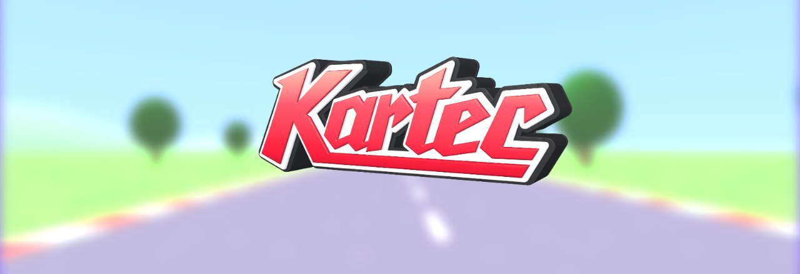

# 🏁 MANUAL DO PILOTO 🏁

### *Super Kartec* — o kart 3D que você joga direto no navegador

 

  

Um jogo do <b>Studio Lumingues</b>

 

> [!NOTE]
> **Bem-vindo, piloto!** Este manual explica tudo o que você precisa para sair da garagem e subir no lugar mais alto do pódio.
> Leia com calma, ou pule direto para a parte que quiser no índice abaixo. 🏎️💨

 

## 📖 ÍNDICE

| | | |
|:---:|:---:|:---:|
| **01** · [O Jogo](#-01--o-jogo) | **02** · [Controles](#-02--controles) | **03** · [Menu Principal](#-03--menu-principal) |
| **04** · [Garagem](#-04--garagem) | **05** · [Preparar Corrida](#-05--preparar-corrida) | **06** · [A Pista](#-06--a-pista-circuito-clássico) |
| **07** · [A Largada](#-07--a-largada) | **08** · [Na Corrida](#-08--na-corrida) | **09** · [Itens](#-09--itens) |
| **10** · [Técnicas de Pilotagem](#-10--técnicas-de-pilotagem) | **11** · [Chegada e Pódio](#-11--chegada-e-pódio) | **12** · [Modo Online](#-12--modo-online) |

 

---

## 🎮 01 · O JOGO

<table>
<tr>
<td width="55%">

**Super Kartec** é um jogo de corrida de kart 3D, colorido e cartunesco, feito para jogar **direto no navegador** — sem instalar nada.

Escolha seu veículo, pinte do seu jeito, encare **7 rivais** na pista e use **drift**, **turbos** e **itens malucos** para cruzar a linha de chegada em primeiro.

Quer desafiar os amigos? Abra uma **sala online** e corra com até **8 pilotos** de verdade.

</td>
<td width="45%">

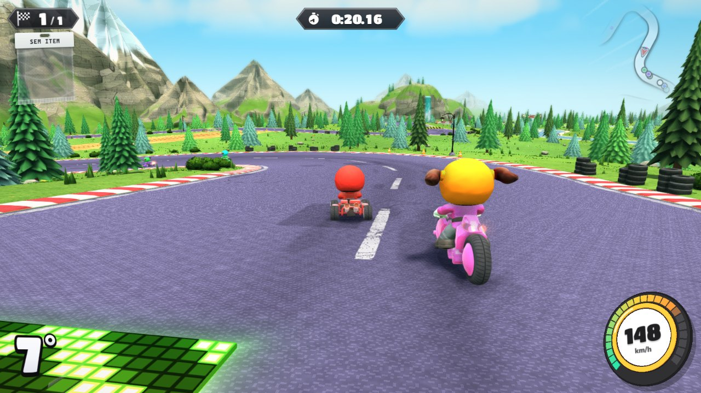

</td>
</tr>
</table>

 

---

## 🕹️ 02 · CONTROLES

| Ação | Teclado | |
|:---|:---:|:---|
| 🟢 **Acelerar** | <kbd>W</kbd> ou <kbd>↑</kbd> | |
| 🔴 **Frear / Ré** | <kbd>S</kbd> ou <kbd>↓</kbd> | |
| ↔️ **Virar** | <kbd>A</kbd> <kbd>D</kbd> ou <kbd>←</kbd> <kbd>→</kbd> | |
| 🌀 **Drift** | <kbd>Espaço</kbd> ou <kbd>Shift</kbd> | *segure enquanto vira* |
| 🎁 **Usar item** | <kbd>E</kbd> | *ou toque no ícone do item* |
| 🏍️ **Dar grau** | <kbd>Ctrl</kbd> | *só na Motoca, numa reta* |
| 👀 **Olhar para trás** | <kbd>C</kbd> | *segure* |
| ⏸️ **Pausa** | <kbd>Esc</kbd> | *reiniciar e sair ficam aqui* |
| 🔄 **Reiniciar corrida** | <kbd>R</kbd> | |
| 🌙 **Avançar 3 horas** | <kbd>N</kbd> | *do dia para a noite!* |
| 🔇 **Som liga/desliga** | <kbd>M</kbd> | |

> [!TIP]
> 🎮 **Tem controle?** Os menus também funcionam no gamepad: <kbd>✛</kbd> navega, <kbd>Start</kbd> confirma e <kbd>B</kbd> volta.

 

---

## 🏠 03 · MENU PRINCIPAL

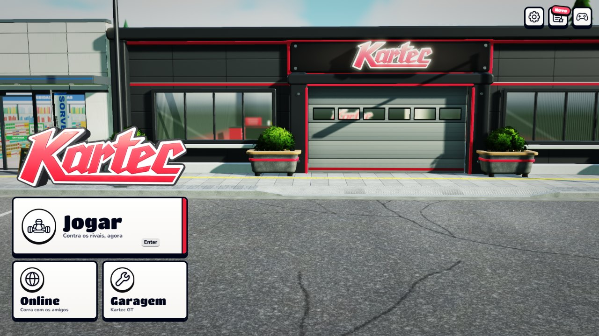

 

A sua jornada começa em frente à **oficina Kartec**. Daqui você vai para qualquer lugar:

| Botão | O que faz |
|:---|:---|
| 🏁 **Jogar** | Corrida contra os rivais do computador, na hora. Atalho: <kbd>Enter</kbd> |
| 🌐 **Online** | Corra contra seus amigos em salas de até 8 jogadores |
| 🔧 **Garagem** | Escolha o veículo, a pintura e o seu piloto |
| ⚙️ **Configurações** | Volume (geral, motores, efeitos, interface, ambiente), gráficos e contador de FPS |
| 📰 **Patch notes** | Tudo o que mudou em cada atualização — o selo **Novo** avisa quando tem novidade |
| 🎮 **Como jogar** | Um resumo rápido dos controles |

 

---

## 🔧 04 · GARAGEM

Ao entrar na garagem, o portão se abre e a câmera mostra o seu veículo em cima da plataforma giratória.
Use as setas <kbd>‹</kbd> <kbd>›</kbd> para trocar de veículo.

### 🚗 Os veículos

<table>
<tr>
<td width="50%" align="center">

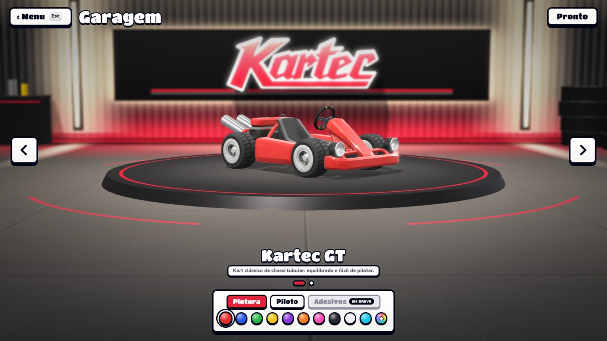

### Kartec GT
*Kart clássico de chassi tubular.*

⚖️ **Equilibrado e fácil de pilotar** — a escolha perfeita para quem está começando.

</td>
<td width="50%" align="center">

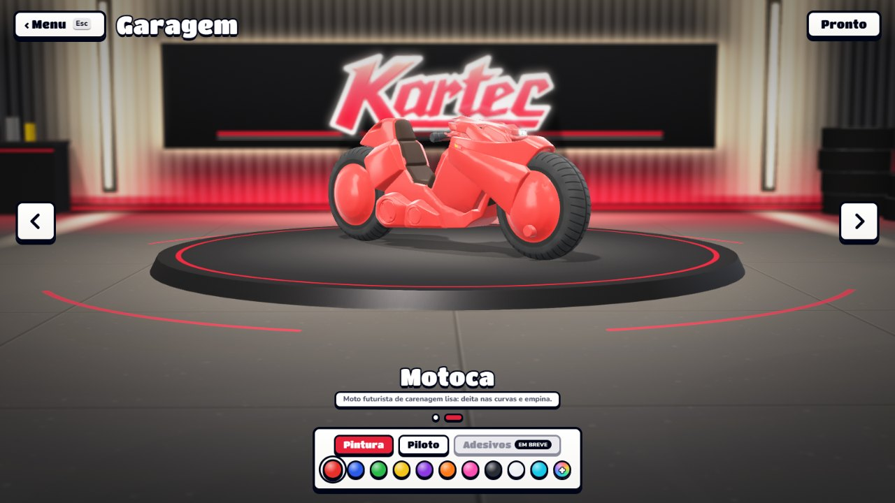

### Motoca
*Moto futurista de carenagem lisa.*

🏍️ **Deita nas curvas e empina!** Segure <kbd>Ctrl</kbd> numa reta para dar grau: fica **6% mais rápida**, mas vira menos e não derrapa.

</td>
</tr>
</table>

### 🎨 Personalize

<table>
<tr>
<td width="50%">

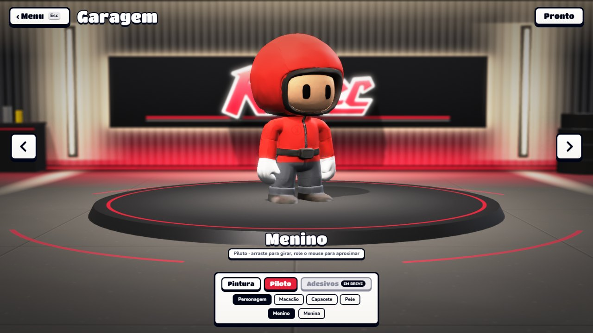

</td>
<td width="50%">

**🖌️ Pintura** — 10 cores para a lataria:

🔴 Vermelho · 🔵 Azul · 🟢 Verde · 🟡 Amarelo · 🟣 Roxo · 🟠 Laranja · 🩷 Rosa · ⚫ Preto · ⚪ Branco · 🩵 Ciano

**🧑 Piloto** — escolha entre **Menino** e **Menina** e combine a cor do **macacão**, do **capacete** e o **tom de pele**.

*Dica: arraste para girar o piloto e role o mouse para aproximar.*

**✨ Adesivos** — `EM BREVE`

</td>
</tr>
</table>

 

---

## 📋 05 · PREPARAR CORRIDA

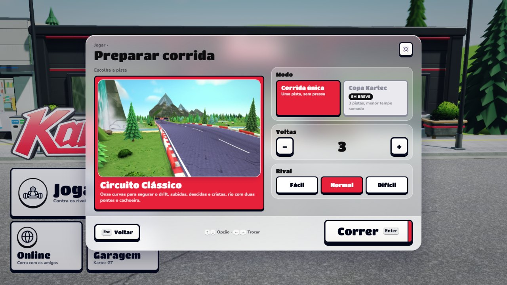

 

Antes de cada corrida você escolhe as regras:

- 🗺️ **Pista** — onde vai ser a disputa.
- 🏆 **Modo** — **Corrida única** (uma pista, sem pressa). A **Copa Kartec** chega em breve!
- 🔁 **Voltas** — de **1 a 5**.
- 🤖 **Rival** — a dificuldade dos adversários:

| 😊 Fácil | 😐 Normal | 😈 Difícil |
|:---:|:---:|:---:|
| Ótimo para aprender | O desafio padrão | Para pilotos de verdade |

 

---

## 🗺️ 06 · A PISTA: CIRCUITO CLÁSSICO

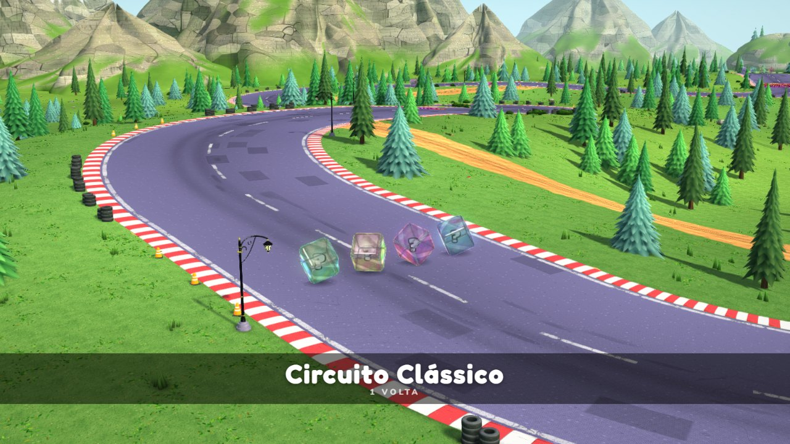

<i>Onze curvas para segurar o drift, subidas, descidas e cristas, rio com duas pontes e cachoeira.</i>

 

### 📍 Mapa do circuito

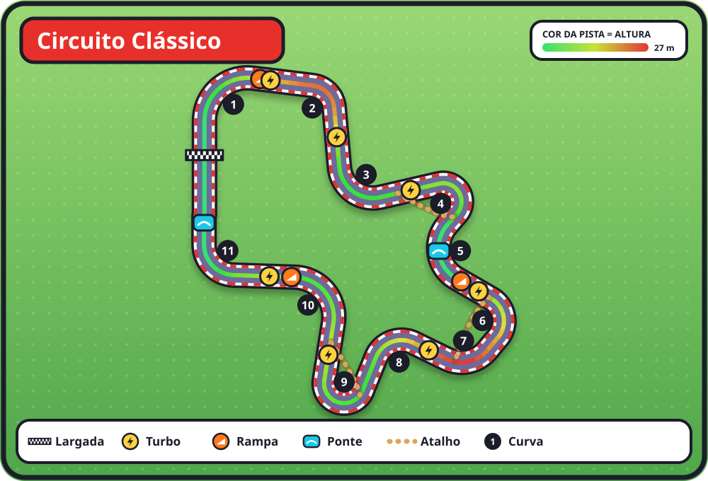

 

<table>
<tr>
<td align="center" width="20%"><h3>📏</h3><b>~3,7 km</b> por volta</td>
<td align="center" width="20%"><h3>↪️</h3><b>11 curvas</b> 2 grampos e 1 dupla</td>
<td align="center" width="20%"><h3>⚡</h3><b>7 turbos</b> plataformas coloridas</td>
<td align="center" width="20%"><h3>🛫</h3><b>3 rampas</b> de salto</td>
<td align="center" width="20%"><h3>🤫</h3><b>3 atalhos</b> de terra batida</td>
</tr>
</table>

### ⛰️ Sobe e desce

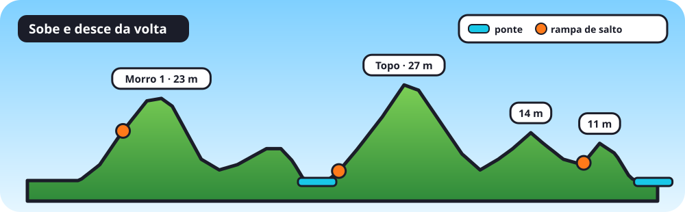

 

> [!TIP]
> 🤫 **Segredo dos atalhos:** em três curvas existe um caminho de **terra batida** cortando por dentro. Na terra o kart fica um pouco mais lento, mas o caminho é tão mais curto que você ainda ganha cerca de **1 segundo**. Os bots não conhecem os atalhos — aproveite!

 

---

## 🧚 07 · A LARGADA

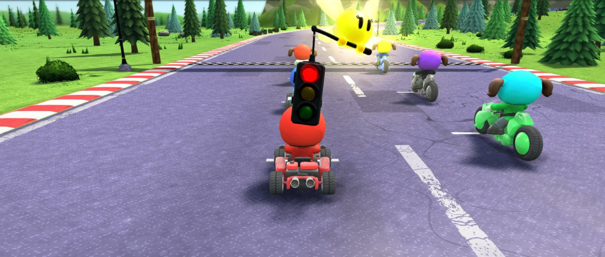

 

Antes de cada corrida, a câmera mostra a pista e o grid com os **8 pilotos**. Aí aparece a **Fatecxie**, a fadinha que segura o semáforo da largada. 🚦

**3... 2... 1... VAI!**

> [!IMPORTANT]
> 🚀 **LARGADA TURBO:** acelere **logo depois do "1"**. Se apertar cedo demais (antes do "2"), você perde o impulso!

### 🤖 Seus rivais

| | Piloto | | Piloto |
|:---:|:---|:---:|:---|
| 🤖 | **Bot Turbo** | 🧪 | **Nina Nitro** |
| ⚡ | **Lia Faísca** | 💨 | **Beto Bala** |
| 🌀 | **Zeca Drift** | 🍃 | **Duda Vento** |
| 🛞 | **Tito Pneu** | | |

 

---

## 🏎️ 08 · NA CORRIDA

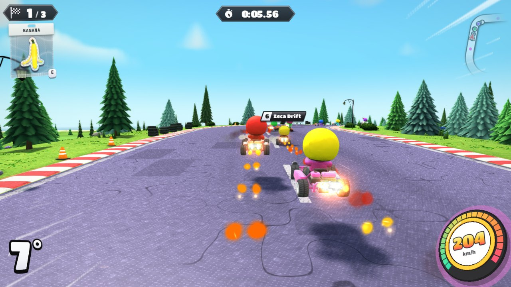

 

### 📺 Entendendo a tela

| Onde | O que mostra |
|:---|:---|
| ↖️ **Canto superior esquerdo** | 🏁 Volta atual e o seu **item** guardado no saquinho |
| ⬆️ **Topo** | ⏱️ Cronômetro da corrida |
| ↗️ **Canto superior direito** | 🗺️ Minimapa com você e os rivais |
| ↙️ **Canto inferior esquerdo** | 🏆 Sua posição (1º a 8º) |
| ↘️ **Canto inferior direito** | 🏎️ Velocímetro 3D — até **135 km/h** normal e **203 km/h** no turbo! |

### 🛣️ O que você encontra na pista

<table>
<tr>
<td width="50%" align="center">

<b>🎁 Caixas de item</b> 
Ficam em fileiras atravessando a pista. Passe por cima para pegar um item! Elas voltam alguns segundos depois.
</td>
<td width="50%" align="center">
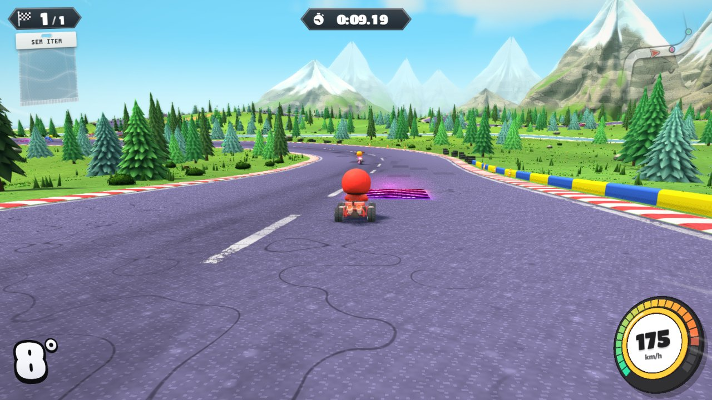
<b>⚡ Plataformas de turbo</b> 
Os pisos coloridos e brilhantes dão um empurrão instantâneo de velocidade.
</td>
</tr>
<tr>
<td width="50%" align="center">
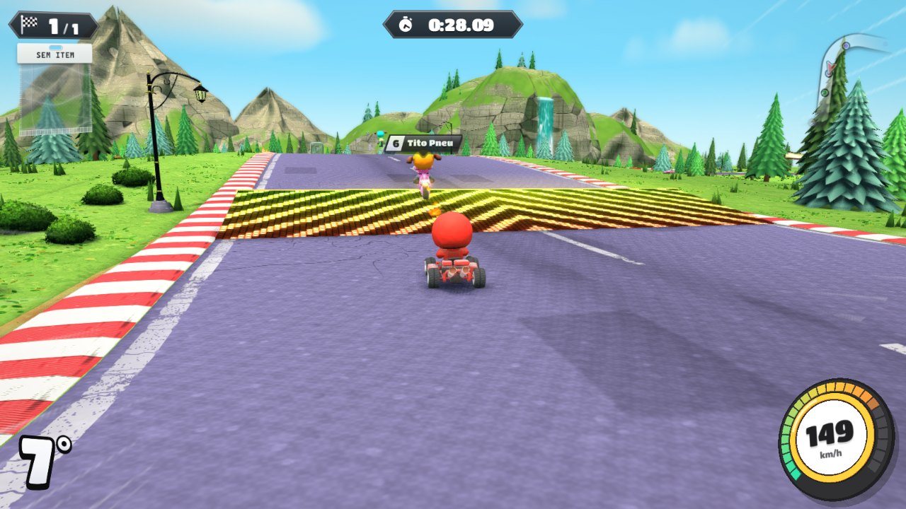
<b>🛫 Rampas de salto</b> 
No ar, aperte o <b>drift</b> para fazer uma <b>manobra</b> — e ganhe turbo ao pousar!
</td>
<td width="50%" align="center">

<b>💥 Batidas de lado</b> 
Encostou de lado num rival? Os karts se empurram. Use isso a seu favor!
</td>
</tr>
</table>

> [!NOTE]
> 🌅 **O tempo passa durante a corrida!** O dia vira tarde e a tarde vira noite. Aperte <kbd>N</kbd> para pular 3 horas e correr sob as luzes dos postes. 🌙

 

---

## 🎁 09 · ITENS

Passou por uma caixa? Uma roleta gira e o item aparece no saquinho do canto da tela. Use com <kbd>E</kbd>. Você só pode guardar **um item por vez**.

<table>
<tr>
<td align="center" width="20%">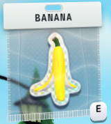 <h3>🍌 Banana</h3></td>
<td align="center" width="20%">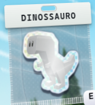 <h3>🦖 Dinossauro</h3></td>
<td align="center" width="20%">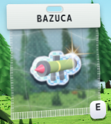 <h3>🚀 Bazuca</h3></td>
<td align="center" width="20%">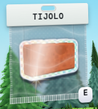 <h3>🧱 Tijolo</h3></td>
<td align="center" width="20%">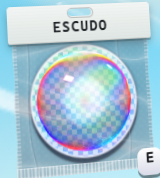 <h3>🫧 Escudo</h3></td>
</tr>
<tr>
<td valign="top">Cai <b>atrás</b> do seu kart. Quem pisar <b>rodopia</b>, perde quase toda a velocidade e demora para voltar a correr.</td>
<td valign="top"><b>Turbo!</b> Dá um empurrão de velocidade por alguns segundos.</td>
<td valign="top">Foguete <b>teleguiado</b> que persegue quem está logo à sua frente e faz o kart <b>capotar</b>.</td>
<td valign="top">Arremessado em quem está <b>logo à frente</b>. Só funciona se o rival estiver perto!</td>
<td valign="top">Bolha de vidro <b>arco-íris</b> que aguenta <b>um ataque</b> (banana, tijolo ou foguete). Dura 10 s e pisca antes de acabar.</td>
</tr>
</table>

 

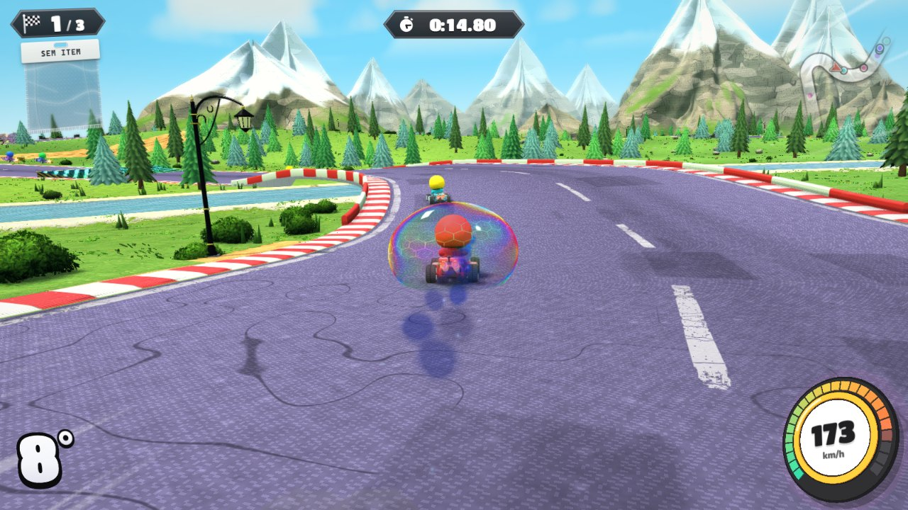

<i>O Escudo protegendo o piloto na pista.</i>

> [!WARNING]
> 🚀 **Bazuca vindo aí!** Quando um foguete está atrás de você, o jogo avisa. Ligue o **Escudo** se tiver um — ou reze! 🙏

 

---

## 🌀 10 · TÉCNICAS DE PILOTAGEM

<table>
<tr>
<td width="50%" valign="top">

### 🔥 Drift e Mini-turbo
Segure <kbd>Espaço</kbd> **enquanto vira** com <kbd>A</kbd>/<kbd>D</kbd>. Sem virar, o drift não liga!

- Virando **para dentro**, o arco fecha.
- Virando **para fora**, o arco abre.
- Solte com **faísca** para ganhar o **mini-turbo**.

A **barra de turbo** ao lado do piloto enche em **3 níveis** — quanto mais cheia, mais forte e mais longo o turbo. No 3º nível você chega a **203 km/h** e as cores do velocímetro começam a girar! 🌈

</td>
<td width="50%" valign="top">

### 🚀 Largada turbo
Acelere logo depois do **"1"** na contagem.

### 💨 Vácuo
Fique **colado atrás** de um rival por um segundo e ganhe um empurrão para ultrapassar.

### 🛫 Manobra no ar
Pulou numa rampa? Aperte o **drift** no ar e ganhe turbo ao pousar.

### 🏍️ Grau (só Motoca)
Segure <kbd>Ctrl</kbd> numa reta: **+6% de velocidade**, mas sem drift.

### 👀 Olhar para trás
Segure <kbd>C</kbd> para ver quem está chegando.

</td>
</tr>
</table>

> [!TIP]
> 🏆 **O segredo dos campeões:** um mini-turbo bem feito em cada uma das **curvas longas** ganha muito tempo. Logo depois de um mini-turbo, a próxima carga demora um pouco mais — escolha bem onde gastar!

 

---

## 🏆 11 · CHEGADA E PÓDIO

<table>
<tr>
<td width="50%">
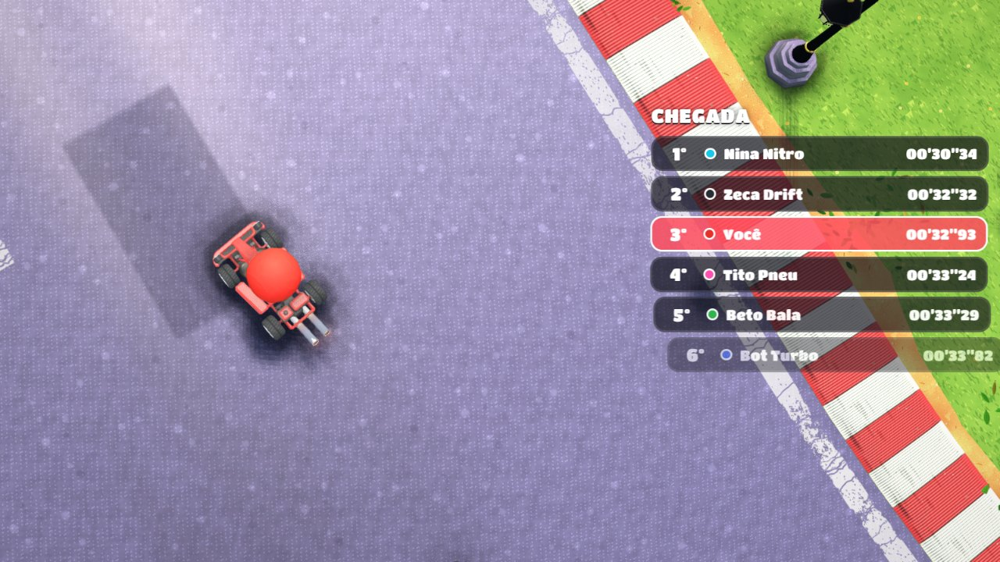

<b>CHEGADA!</b> O placar mostra a posição e o tempo de cada piloto conforme eles cruzam a linha.

</td>
<td width="50%">
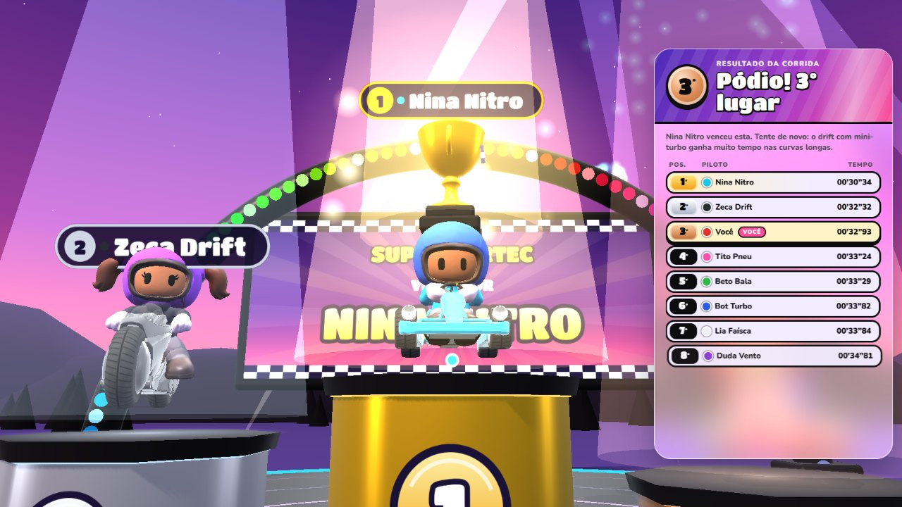

<b>PÓDIO!</b> Os 3 melhores sobem no pódio com troféu e festa. Depois é só jogar de novo!

</td>
</tr>
</table>

 

---

## 🌐 12 · MODO ONLINE

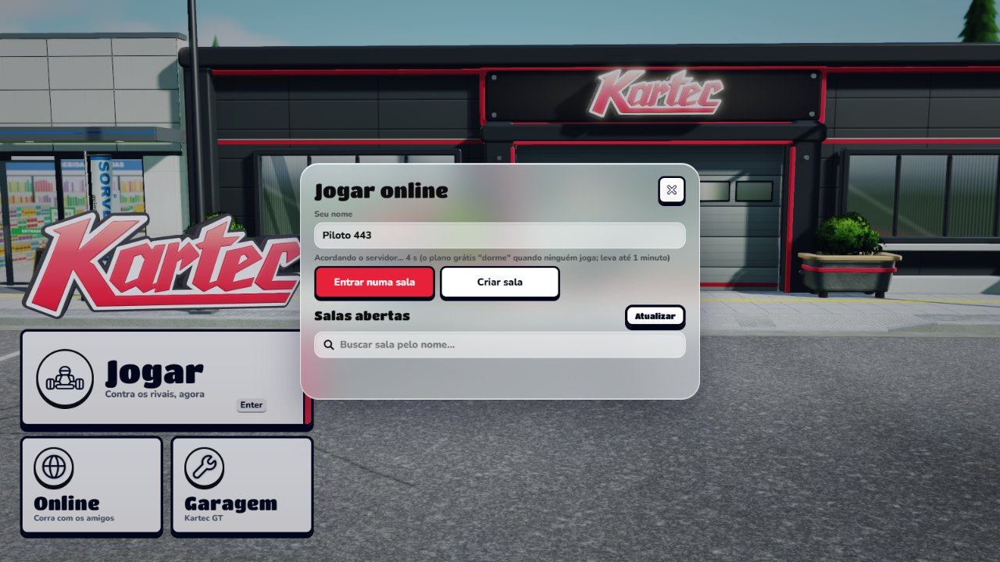

 

Corra com seus amigos, cada um no seu computador!

| Passo | |
|:---:|:---|
| **1** | No menu, clique em **🌐 Online** e escolha seu nome de piloto |
| **2** | **Criar sala:** dê um nome, escolha a pista, as voltas e quantos jogadores (2 a 8). A senha é opcional! |
| **3** | Seus amigos clicam em **Entrar numa sala** e procuram a sala pelo nome |
| **4** | Todo mundo marca **Estou pronto** e quem criou a sala clica em **Iniciar corrida** 🏁 |

> [!NOTE]
> 🔌 **Caiu a internet ou fechou a aba sem querer?** Calma! Você tem **15 segundos** para voltar e continua na mesma corrida.
>
> 😴 Se ninguém jogou por um tempo, o servidor pode estar "dormindo". A tela mostra *"Acordando o servidor…"* e conecta sozinha em até 1 minuto.

 

---

## 🏁 PRONTO PARA CORRER?

  

**Boa corrida, piloto!** 🏆

 

Feito com ❤️ pelo <b>Studio Lumingues</b>

 

👨‍💻 Para desenvolvedores: como rodar no computador, publicar o servidor e otimizar os modelos 3D está no <a href="docs/TECNICO.md">guia técnico</a>.

